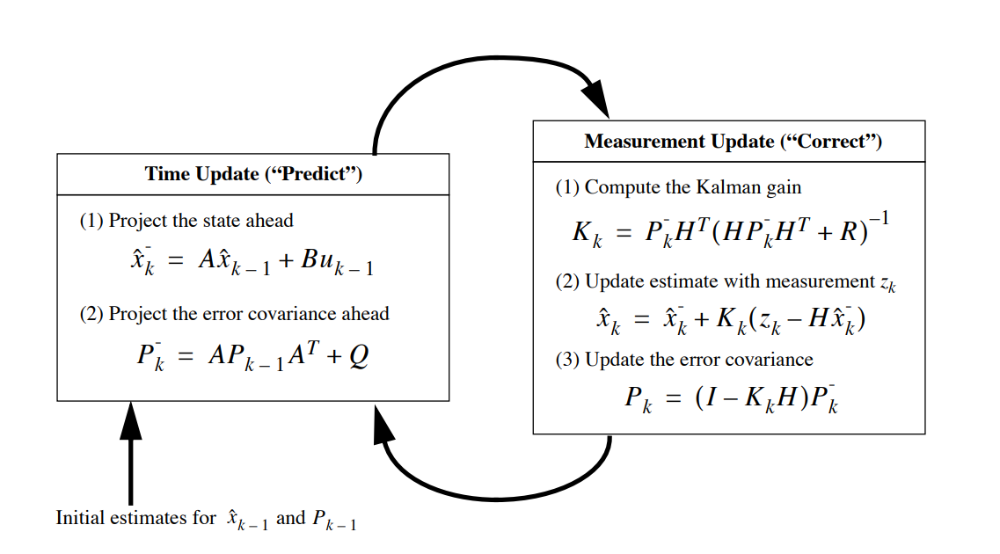
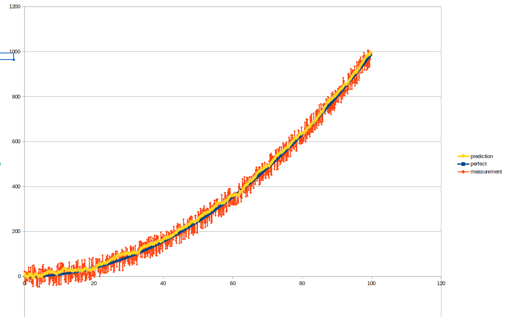
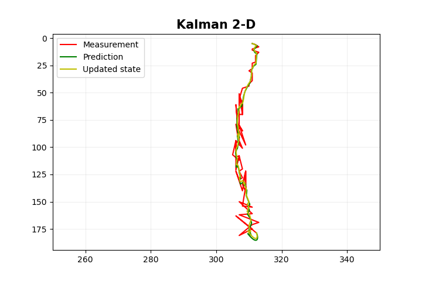
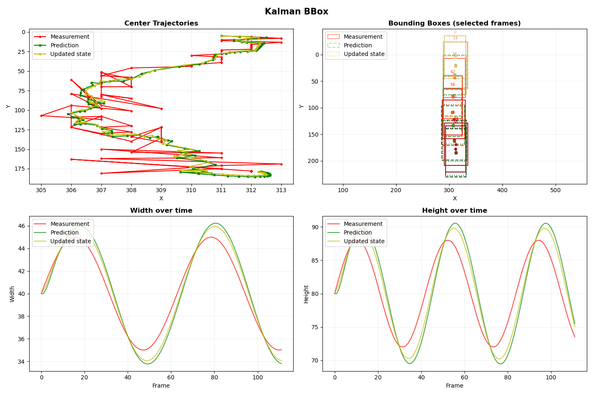

# Implementation of Discrete Kalman filter for object tracking purposes

The Kalman filter estimates the state of a system at time $k$ via the linear stochastic difference equation considering the state of a system at time $k$ is evolved from the previous state at time $k-1$. See the ref. https://en.wikipedia.org/wiki/Kalman_filter

In other words, the purpose of Kalman filter is to predict the next state via using prior knowledge of the current state. 

In this repository Hybrid Kalman filter is implemented considering continuous-time model while discrete-time measurements. See the ref. - https://en.wikipedia.org/wiki/Kalman_filter#Hybrid_Kalman_filter

## Table of Contents

- [Main algorithm and equations](#main-algorithm-and-equations)
- [1-D Kalman filter](#1-d-kalman-filter)
- [2-D Kalman filter](#2-d-kalman-filter)
- [Bounding Box Kalman filter (KalmanBBox)](#bounding-box-kalman-filter-kalmanbbox)
- [How to use](#how-to-use)
- [References](#References)

## Main algorithm and equations

Define mentioned _linear stochastic difference equation_:

$$\chi_{k} = A⋅\chi_{k-1} + B⋅u_{k-1} + w_{k-1} \tag{1}$$

Define measurement model:
$$z_{k} = H⋅\chi_{k} + v_{k}\tag{2}$$

Let's denote variables:

* $A$ (sometimes it's written as $F$, but I prefer to stick with $A$) - [Transition matrix](https://en.wikipedia.org/wiki/State-transition_matrix) of size $n \times n$ relating state $k-1$ to state $k$
* $B$ - Control input matrix of size $n \times l$ which is applied to *optional* control input $u_{k-1}$
* $H$ - Transformation (observation) matrix of size $m \times n$.
* $u_{k}$ - Control input
* $w_{k}$ - Process noise vector with covariance $Q$. Gaussian noise with the normal probability distribution:
$$w(t) \sim N(0, Q) \tag{3}$$
* $v_{k}$ - Measurement noise vector (uncertainty) with covariance $R$. Gaussian noise with the normal probability distribution:
$$v(t) \sim N(0, R) \tag{4}$$

### Prediction

Let's use the dash sign " $-$ " as superscript to indicate the a priory state.

A priory state in matrix notation is defined as

$$\hat{\chi}^-_ {k} = A⋅\hat{\chi}_ {k-1} + B⋅u_ {k-1} \tag{5}$$

$$\text{, where $\hat{\chi}^-_ {k}$ - a priory state (a.k.a. predicted),  $\hat{\chi}_ {k-1}$ - a posteriory state (a.k.a. previous)} $$

__Note: A posteriory state $\hat{\chi}_{k-1}$ on 0-th time step (initial) should be *guessed*__

Error covariance matrix $P^-$ is defined as

$$P^-_ {k} =  A⋅P_ {k-1}⋅A^{T} + Q \tag{6}$$

$$\text{, where $P_ {k-1}$ - previously estimated error covariance matrix of size $n \times n$ (should match transition matrix dimensions), } $$
$$\text{Q - process noise covariance}$$

__Note:__ $P_ {k-1}$ __on 0-th time step (initial) should be *guessed*__

### Correction

The Kalman gain (which minimizes the estimate variance) in matrix notation is defined as:

$$K_ {k} = P^-_ {k}⋅H^{T}⋅(H⋅P^-_ {k}⋅H^{T}+R)^{-1} \tag{7}$$

$$\text{, where H - transformation matrix, R - measurement noise covariance}$$

After evaluating the Kalman gain we need to update a priory state $\hat{\chi}^-_ {k}$. In order to do that we need to calculate measurement residual:

$$r_ {k} = z_ {k} - H⋅\hat{\chi}^-_ {k} \tag{8}$$

$$\text{, where $z_ {k}$ - true measurement, $H⋅\hat{\chi}^-_ {k}$ - previously estimated measurement}$$

Then we can update predicted state $\hat{\chi}_ {k}$:

$$\hat{\chi}_ {k} = \hat{\chi}^-_ {k} + K_{k}⋅r_{k}$$

$$\text{or} \tag{9}$$

$$\hat{\chi}_ {k} = \hat{\chi}^-_ {k} + K_{k}⋅(z_{k} - H⋅\hat{\chi}^-_{k})$$

After that we should update error covariance matrix $P_{k}$ which will be used in next time stap (an so on):
$$P_{k} = (I - K_{k}⋅H)⋅P^-_{k}\tag{10}$$
$$\text{, where $I$ - identity matrix (square matrix with ones on the main diagonal and zeros elsewhere)}$$


### Overall
The whole algorithm can be described as high-level diagram:
<p align="center">

<p align="center">Fig 1. Operation of the Kalman filter. Welch & Bishop, 'An Introduction to the Kalman Filter'</p>
</p>

## 1-D Kalman filter

Considering acceleration motion let's write down its equations:

Velocity:
$$v = v_{0} + at \tag{11}$$
$$v(t) = x'(t) $$
$$a(t) = v'(t) = x''(t)$$

Position:
$$x = x_{0} + v_{0}t + \frac{at^2}{2} \tag{12}$$

Let's write $(11)$ and $(12)$ in Lagrange form:

$$x'_ {k} = x'_ {k-1} + x''_{k-1}\Delta t \tag{13}$$

$$x_{k} = x_{k-1} + x'_ {k-1}\Delta t + \frac{x''_{k-1}(\Delta t^2)}{2} \tag{14}$$

State vector $\chi_{k}$ looks like:

$$\chi_{k} = \begin{bmatrix}
x_{k} \\
x'_ {k}
\end{bmatrix} = \begin{bmatrix}
x_{k-1} + x'_ {k-1}\Delta t + \frac{x''_ {k-1}(\Delta t^2)}{2} \\
x'_ {k-1} + x''_{k-1}\Delta t
\end{bmatrix} \tag{15}$$

Matrix form of $\chi_{k}$ :

$$\chi_{k} = \begin{bmatrix} x_{k} \\
x'_ {k} \end{bmatrix} = \begin{bmatrix} 1 & \Delta t \\
0 & 1\end{bmatrix} ⋅ \begin{bmatrix} x_{k-1} \\
x'_ {k-1} \end{bmatrix} + \begin{bmatrix} \frac{\Delta t^2}{2} \\
\Delta t \end{bmatrix} ⋅ x''_ {k-1} = \begin{bmatrix} 1 & \Delta t \\
0 & 1\end{bmatrix} ⋅ \chi_{k-1} + \begin{bmatrix} \frac{\Delta t^2}{2} \\
\Delta t \end{bmatrix} ⋅ x''_{k-1} \tag{16}$$


Taking close look on $(16)$ and $(1)$ we can write transition matrix $A$ and control input matrix $B$ as follows:

$$A = \begin{bmatrix} 1 & \Delta t \\
0 & 1\end{bmatrix} \tag{17}$$

$$B = \begin{bmatrix} \frac{\Delta t^2}{2} \\
\Delta t \end{bmatrix} \tag{18}$$

Let's find transformation matrix $H$. According to $(2)$:

$$z_{k} = H⋅\chi_{k} + v_{k} = \begin{bmatrix} 1 & 0 \end{bmatrix} ⋅\begin{bmatrix} x_{k} \\
{x'_ {k}} \end{bmatrix} + v_{k} \tag{19}$$

$$ H = \begin{bmatrix} 1 & 0 \end{bmatrix} \tag{20}$$

__Notice:__ $v_{k}$ __in__ $(19)$ __- is not speed, but measurement noise! Don't be confused with notation. E.g.:__ 

$$ \text{$ \chi_{k} = \begin{bmatrix} 375.74 \\
0 - \text{assume zero velocity}  \end{bmatrix} $, $ v_{k} = 2.64 => $} $$

$$ \text{$ => z_{k} = \begin{bmatrix} 1 & 0 \end{bmatrix} ⋅\begin{bmatrix} 375.74 \\
0 \end{bmatrix} + 2.64 = \begin{bmatrix} 378.38 & 2.64 \end{bmatrix} $ - you can see that first vector argument it is just noise $v_{k}$ added}$$

$$ \text{to observation $x_{k}$ and the second argument is noise $v_{k}$ itself.}$$

Process noise covariance matrix $Q$:

$$Q = \begin{matrix}
 & \begin{matrix}x && x'\end{matrix} \\
\begin{matrix}x \\
x'\end{matrix} & 
  \begin{bmatrix} \sigma^2_{x} & \sigma_{x} \sigma_{x'} \\
\sigma_{x'} \sigma_{x} & \sigma^2_{x'}\end{bmatrix}
 \\\\
\end{matrix} \tag{21}$$

$$\text{, where} $$

$$ \text{$\sigma_{x}$ - standart deviation of position} $$

$$ \text{$\sigma_{x'}$ - standart deviation of velocity} $$

Since we know about $(14)$ we can define $\sigma_{x}$ and $\sigma_{x'}$ as:

$$ \sigma_{x} = \sigma_{x''} \frac{\Delta t^2}{2} \tag{22}$$

$$ \sigma_{x'} = \sigma_{x''} \Delta t \tag{23}$$

$$\text{, where $\sigma_{x''}$ - standart deviation of acceleration (tuned value)} $$

And now process noise covariance matrix $Q$ could be defined as:

$$ Q = \begin{bmatrix} (\sigma_{x''} \frac{\Delta t^2}{2})^2 & \sigma_{x''} \frac{\Delta t^2}{2} \sigma_{x''} \Delta t  \\
\sigma_{x''} \Delta t \sigma_{x''} \frac{\Delta t^2}{2} & (\sigma_{x''} \Delta t)^2 \end{bmatrix} = $$

$$ = \begin{bmatrix} (\sigma_{x''} \frac{\Delta t^2}{2})^2 & (\sigma_{x''})^2 \frac{\Delta t^2}{2} \Delta t  \\
(\sigma_{x''})^2 \Delta t \frac{\Delta t^2}{2} & (\sigma_{x''} \Delta t)^2 \end{bmatrix} = \begin{bmatrix} (\frac{\Delta t^2}{2})^2 & \frac{\Delta t^2}{2} \Delta t  \\
\Delta t \frac{\Delta t^2}{2} & \Delta t^2 \end{bmatrix} \sigma^2_{x''}$$

$$ = \begin{bmatrix} \frac{\Delta t^4}{4} & \frac{\Delta t^3}{2} \\
\frac{\Delta t^3}{2} & \Delta t^2 \end{bmatrix} \sigma^2_{x''} \tag{24}$$

$$ \text{Assuming that $x''$ - is acceleration $a$, $Q = \begin{bmatrix} \frac{\Delta t^4}{4} & \frac{\Delta t^3}{2} \\
\frac{\Delta t^3}{2} & \Delta t^2 \end{bmatrix} \sigma^2_{a}$} \tag{25}$$

Covariance of measurement noise $R$ is scalar (matrix of size $1 \times 1$) and it is defined as variance of the measurement noise:

$$R = \begin{matrix}
\begin{matrix}& x\end{matrix} \\
\begin{matrix}x\end{matrix}
  \begin{bmatrix}\sigma^2_{z}\end{bmatrix}
 \\\\
\end{matrix} = \sigma^2_{z} \tag{26}$$

Rust implementation is [here](./src/kalman/kalman_1d.rs#L4)

Example of usage:
```rust
    let dt = 0.1;
    let u = 2.0;
    let std_dev_a = 0.25;
    let std_dev_m = 1.2;

    let t: nalgebra::SVector::<f32, 1000> = nalgebra::SVector::<f32, 1000>::from_iterator(float_loop(0.0, 100.0, dt));
    let track = t.map(|t| dt*(t*t - t));


    let mut kalman = Kalman1D::new(dt, u, std_dev_a, std_dev_m);
    let mut measurement: Vec<f32> = vec![];
    let mut predictions: Vec<f32>= vec![];
    for (t, x) in t.iter().zip(track.iter()) {
        // Add some noise to perfect track
        let v: f32 = StdRng::from_entropy().sample::<f32, Standard>(Standard) * (50.0+50.0) - 50.0; // Generate noise in [-50, 50)
        let z = kalman.H.x * x + v;
        measurement.push(z);

        // Predict stage
        kalman.predict();
        predictions.push(kalman.x.x);

        // Update stage
        kalman.update(z).unwrap();
    }
    println!("time;perfect;measurement;prediction");
    for i in 0..track.len() {
        println!("{};{};{};{}", t[i], track[i], measurement[i], predictions[i]);
    }
```

How exported chart does look like:



## 2-D Kalman filter

Considering acceleration motion again let's write down its equations:

Considering the same physical model as in $(13)$ - $(14)$ let's write down state vector $\chi_{k}$:

$$\chi_{k} = \begin{bmatrix}
x_{k} \\
y_{k} \\
x'_ {k} \\
y'_ {k} \end{bmatrix} = \begin{bmatrix}
x_{k-1} + x'_ {k-1}\Delta t + \frac{x''_ {k-1}(\Delta t^2)}{2} \\
y_{k-1} + y'_ {k-1}\Delta t + \frac{y''_ {k-1}(\Delta t^2)}{2} \\
x'_ {k-1} + x''_ {k-1}\Delta t \\
y'_ {k-1} + y''_ {k-1}\Delta t
\end{bmatrix} \tag{27}$$

Matrix form of $\chi_{k}$ :

$$\chi_{k} = \begin{bmatrix} x_{k} \\
y_{k} \\
x'_ {k} \\
y'_ {k}
\end{bmatrix} = \begin{bmatrix} 1 & 0 & \Delta t & 0 \\
0 & 1 & 0 & \Delta t \\
0 & 0 & 1 & 0 \\
0 & 0 & 0 & 1 \end{bmatrix} ⋅ \begin{bmatrix} x_{k-1} \\
y_{k-1} \\
x'_ {k-1} \\
y'_ {k-1} \end{bmatrix} + \begin{bmatrix} \frac{\Delta t^2}{2} & 0 \\
0 & \frac{\Delta t^2}{2} \\
\Delta t & 0 \\
0 & \Delta t \end{bmatrix} ⋅ \begin{bmatrix} x''_ {k-1} \\
y''_ {k-1} \end{bmatrix} = $$
$$ = \begin{bmatrix} 1 & 0 & \Delta t & 0 \\
0 & 1 & 0 & \Delta t \\
0 & 0 & 1 & 0 \\
0 & 0 & 0 & 1 \end{bmatrix} ⋅ \chi_{k-1} + \begin{bmatrix} \frac{\Delta t^2}{2} & 0 \\
0 & \frac{\Delta t^2}{2} \\
\Delta t & 0 \\
0 & \Delta t \end{bmatrix} ⋅ \begin{bmatrix} x''_ {k-1} \\
y''_{k-1} \end{bmatrix} \tag{28}$$

$$ \text{Assuming that $x''$ and $y''$ - is acceleration $a$, }$$

$$ a_{k-1} = \begin{bmatrix} x''_ {k-1} \\
y''_{k-1} \end{bmatrix} \tag{29}$$

$$\chi_{k} = \begin{bmatrix} x_{k} \\
y_{k} \\
x'_ {k} \\
y'_ {k}
\end{bmatrix} = \begin{bmatrix} 1 & 0 & \Delta t & 0 \\
0 & 1 & 0 & \Delta t \\
0 & 0 & 1 & 0 \\
0 & 0 & 0 & 1 \end{bmatrix} ⋅ \chi_{k-1} + \begin{bmatrix} \frac{\Delta t^2}{2} & 0 \\
0 & \frac{\Delta t^2}{2} \\
\Delta t & 0 \\
0 & \Delta t \end{bmatrix} ⋅ a_{k-1} \tag{30}$$


Taking close look on $(16)$ and $(1)$ we can write transition matrix $A$ and control input matrix $B$ as follows:

$$A = \begin{bmatrix} 1 & 0 & \Delta t & 0 \\
0 & 1 & 0 & \Delta t \\
0 & 0 & 1 & 0 \\
0 & 0 & 0 & 1 \end{bmatrix} \tag{31}$$

$$B = \begin{bmatrix} \frac{\Delta t^2}{2} & 0 \\
0 & \frac{\Delta t^2}{2} \\
\Delta t & 0 \\
0 & \Delta t \end{bmatrix} \tag{32}$$

Let's find transformation matrix $H$. According to $(2)$ and $(19)$ - $(20)$:

$$z_{k} = H⋅\chi_{k} + v_{k} = \begin{bmatrix} 1 & 0 & 0 & 0 \\
0 & 1 & 0 & 0 \end{bmatrix} ⋅\begin{bmatrix} x_{k} \\
y_{k} \\
{x'_  {k}} \\
{y'_ {k}} \end{bmatrix} + v_{k} \tag{33}$$

$$ H = \begin{bmatrix} 1 & 0 & 0 & 0 \\
0 & 1 & 0 & 0 \end{bmatrix} \tag{34}$$

Process noise covariance matrix $Q$:

$$Q = \begin{matrix}
 & \begin{matrix}x && y && x' && y'\end{matrix} \\
\begin{matrix}x \\
y \\
x' \\
y'\end{matrix} & 
  \begin{bmatrix} \sigma^2_{x} & 0 & \sigma_{x} \sigma_{x'} & 0 \\
0 & \sigma^2_{y} & 0 & \sigma_{y} \sigma_{y'} \\
\sigma_{x'} \sigma_{x} & 0 & \sigma^2_{x'} & 0 \\
0 & \sigma_{y'} \sigma_{y} & 0 & \sigma^2_{y'}\end{bmatrix}
 \\\\
\end{matrix} \tag{35}$$

$$\text{, where} $$

$$ \text{$\sigma_{x}$ - standart deviation of position for $x$ component} $$

$$ \text{$\sigma_{y}$ - standart deviation of position for $y$ component} $$

$$ \text{$\sigma_{x'}$ - standart deviation of velocity for $x$ component} $$

$$ \text{$\sigma_{y'}$ - standart deviation of velocity for $y$ component} $$

Since we know about $(14)$ we can define $\sigma_{x}$, $\sigma_{y}$, $\sigma_{x'}$ and $\sigma_{y'}$ as:

$$ \sigma_{x} = \sigma_{x''} \frac{\Delta t^2}{2} \tag{36}$$

$$ \sigma_{y} = \sigma_{y''} \frac{\Delta t^2}{2} \tag{37}$$

$$ \sigma_{x'} = \sigma_{x''} \Delta t \tag{38}$$

$$ \sigma_{y'} = \sigma_{y''} \Delta t \tag{39}$$

$$\text{, where $\sigma_{x''}$ and $\sigma_{y''}$ - standart deviation of acceleration (tuned values)} $$

And now process noise covariance matrix $Q$ could be defined as:

$$ Q = \begin{bmatrix} (\sigma_{x''} \frac{\Delta t^2}{2})^2 & 0 & \sigma_{x''} \frac{\Delta t^2}{2} \sigma_{x''} \Delta t & 0 \\
0 & (\sigma_{y''} \frac{\Delta t^2}{2})^2 & 0 & \sigma_{y''} \frac{\Delta t^2}{2} \sigma_{y''} \Delta t \\
\sigma_{x''} \frac{\Delta t^2}{2} \sigma_{x''} \Delta t & 0 & (\sigma_{x''} \Delta t)^2 & 0 \\
0 & \sigma_{y''} \frac{\Delta t^2}{2} \sigma_{y''} \Delta t & 0 & (\sigma_{y''} \Delta t)^2 \end{bmatrix} = $$

$$ = \begin{bmatrix} (\sigma_{x''} \frac{\Delta t^2}{2})^2 & 0 & (\sigma_{x''})^2 \frac{\Delta t^2}{2} \Delta t & 0 \\
0 & (\sigma_{y''} \frac{\Delta t^2}{2})^2 & 0 & (\sigma_{y''})^2 \frac{\Delta t^2}{2} \Delta t \\
(\sigma_{x''})^2 \frac{\Delta t^2}{2} \Delta t & 0 & (\sigma_{x''} \Delta t)^2 & 0 \\
0 & (\sigma_{y''})^2 \frac{\Delta t^2}{2}\Delta t & 0 & (\sigma_{y''} \Delta t)^2 \end{bmatrix} = \text{| Knowing that $x''$ and $y''$ - acceleration|} = $$ 
$$ = \begin{bmatrix} (\frac{\Delta t^2}{2})^2 & 0 & \frac{\Delta t^2}{2} \Delta t & 0 \\
0 & (\frac{\Delta t^2}{2})^2 & 0 & \frac{\Delta t^2}{2} \Delta t \\
\frac{\Delta t^2}{2} \Delta t & 0 & \Delta t^2 & 0 \\
0 & \Delta t \frac{\Delta t^2}{2} & 0 & \Delta t^2 \end{bmatrix} \sigma^2_{a''}$$

$$ = \begin{bmatrix} \frac{\Delta t^4}{4} & 0 & \frac{\Delta t^3}{2} & 0 \\
0 & \frac{\Delta t^4}{4} & 0 & \frac{\Delta t^3}{2} \\
\frac{\Delta t^3}{2} & 0 & \Delta t^2 & 0 \\
0 & \frac{\Delta t^3}{2} & 0 & \Delta t^2 \end{bmatrix} \sigma^2_{a''} \tag{40}$$

Covariance of measurement noise $R$ is matrix of size $2 \times 2$ (since there are two components - $x$ and $y$) and it is defined as variance of the measurement noise:

$$R = \begin{matrix}
\begin{matrix}& x & y\end{matrix} \\
\begin{matrix}x \\
y \end{matrix}
  \begin{bmatrix}\sigma^2_{x} & 0 \\
  0 & \sigma^2_{y} \end{bmatrix}
 \\\\
\end{matrix} = \begin{bmatrix}\sigma^2_{x} & 0 \\
  0 & \sigma^2_{y} \end{bmatrix} \tag{41}$$

Rust implementation is [here](./src/kalman/kalman_2d.rs#L4)

Example of usage:
```rust
    let dt = 0.04; // 1/25 = 25 fps - just an example
    let ux = 1.0;
    let uy = 1.0;
    let std_dev_a = 2.0;
    let std_dev_mx = 0.1;
    let std_dev_my = 0.1;

    // Sample measurements
    // Note: in this example Y-axis going from up to down
    let xs = vec![311, 312, 313, 311, 311, 312, 312, 313, 312, 312, 312, 312, 312, 312, 312, 312, 312, 312, 311, 311, 311, 311, 311, 310, 311, 311, 311, 310, 310, 308, 307, 308, 308, 308, 307, 307, 307, 308, 307, 307, 307, 307, 307, 308, 307, 309, 306, 307, 306, 307, 308, 306, 306, 306, 305, 307, 307, 307, 306, 306, 306, 307, 307, 308, 307, 307, 308, 307, 306, 308, 309, 309, 309, 309, 308, 309, 309, 309, 308, 311, 311, 307, 311, 307, 313, 311, 307, 311, 311, 306, 312, 312, 312, 312, 312, 312, 312, 312, 312, 312, 312, 312, 312, 312, 312, 312, 312, 312, 312, 312, 312, 312];
    let ys = vec![5, 6, 8, 10, 11, 12, 12, 13, 16, 16, 18, 18, 19, 19, 20, 20, 22, 22, 23, 23, 24, 24, 28, 30, 32, 35, 39, 42, 44, 46, 56, 58, 70, 60, 52, 64, 51, 70, 70, 70, 66, 83, 80, 85, 80, 98, 79, 98, 61, 94, 101, 94, 104, 94, 107, 112, 108, 108, 109, 109, 121, 108, 108, 120, 122, 122, 128, 130, 122, 140, 122, 122, 140, 122, 134, 141, 136, 136, 154, 155, 155, 150, 161, 162, 169, 171, 181, 175, 175, 163, 178, 178, 178, 178, 178, 178, 178, 178, 178, 178, 178, 178, 178, 178, 178, 178, 178, 178, 178, 178, 178, 178];
    
    let mut kalman = Kalman2D::new(dt, ux, uy, std_dev_a, std_dev_mx, std_dev_my);
    // Assume that initial X,Y coordinates match the first measurement
    kalman.x.x = xs[0] as f32;
    kalman.x.y = ys[0] as f32;
    let mut predictions: Vec<Vec<f32>> = vec![];
    for (x, y) in xs.iter().zip(ys.iter()) {
        // Considering that the measurements are noisy
        let mx = *x as f32;
        let my = *y as f32;

        // Predict stage
        kalman.predict();
        predictions.push(vec![kalman.x.x, kalman.x.y]);

        // Update stage
        kalman.update(mx, my).unwrap();
    }
    println!("measurement X;measurement Y;prediction X;prediction Y");
    for i in 0..xs.len() {
        println!("{};{};{};{}", xs[i], ys[i], predictions[i][0], predictions[i][1]);
    }
```

How exported chart does look like:



## Bounding Box Kalman filter (KalmanBBox)

For multi-object tracking (MOT) purposes, tracking only center position $(x, y)$ is insufficient. Objects can change size due to movement towards/away from camera, aspect ratio variations, or partial occlusions. We extend the 2-D Kalman filter to track bounding box parameters: center coordinates $(c_x, c_y)$, width $w$, and height $h$.

Considering constant velocity model for both position and size, let's write down the equations.

For center position (same physical model as in $(13)$ - $(14)$):

$${c_x}_ {k} = {c_x}_ {k-1} + {c'_x}_ {k-1}\Delta t + \frac{{c''_x}_ {k-1}(\Delta t^2)}{2} \tag{42}$$

$${c_y}_ {k} = {c_y}_ {k-1} + {c'_y}_ {k-1}\Delta t + \frac{{c''_y}_ {k-1}(\Delta t^2)}{2} \tag{43}$$

For bounding box dimensions (analogous dynamics):

$$w_{k} = w_{k-1} + w'_ {k-1}\Delta t + \frac{w''_ {k-1}(\Delta t^2)}{2} \tag{44}$$

$$h_{k} = h_{k-1} + h'_ {k-1}\Delta t + \frac{h''_ {k-1}(\Delta t^2)}{2} \tag{45}$$

$$\text{, where $w'$ and $h'$ - rate of change of width and height respectively}$$

And for velocities:

$${c'_x}_ {k} = {c'_x}_ {k-1} + {c''_x}_ {k-1}\Delta t \tag{46}$$

$${c'_y}_ {k} = {c'_y}_ {k-1} + {c''_y}_ {k-1}\Delta t \tag{47}$$

$$w'_ {k} = w'_ {k-1} + w''_ {k-1}\Delta t \tag{48}$$

$$h'_ {k} = h'_ {k-1} + h''_ {k-1}\Delta t \tag{49}$$

State vector $\chi_{k}$ for bounding box:

$$\chi_{k} = \begin{bmatrix}
{c_x}_ {k} \\
{c_y}_ {k} \\
w_{k} \\
h_{k} \\
{c'_x}_ {k} \\
{c'_y}_ {k} \\
w'_ {k} \\
h'_ {k}
\end{bmatrix} = \begin{bmatrix}
{c_x}_ {k-1} + {c'_x}_ {k-1}\Delta t + \frac{{c''_x}_ {k-1}(\Delta t^2)}{2} \\
{c_y}_ {k-1} + {c'_y}_ {k-1}\Delta t + \frac{{c''_y}_ {k-1}(\Delta t^2)}{2} \\
w_{k-1} + w'_ {k-1}\Delta t + \frac{w''_ {k-1}(\Delta t^2)}{2} \\
h_{k-1} + h'_ {k-1}\Delta t + \frac{h''_ {k-1}(\Delta t^2)}{2} \\
{c'_x}_ {k-1} + {c''_x}_ {k-1}\Delta t \\
{c'_y}_ {k-1} + {c''_y}_ {k-1}\Delta t \\
w'_ {k-1} + w''_ {k-1}\Delta t \\
h'_ {k-1} + h''_ {k-1}\Delta t
\end{bmatrix} \tag{50}$$

Matrix form of $\chi_{k}$:

$$\chi_{k} = \begin{bmatrix}
1 & 0 & 0 & 0 & \Delta t & 0 & 0 & 0 \\
0 & 1 & 0 & 0 & 0 & \Delta t & 0 & 0 \\
0 & 0 & 1 & 0 & 0 & 0 & \Delta t & 0 \\
0 & 0 & 0 & 1 & 0 & 0 & 0 & \Delta t \\
0 & 0 & 0 & 0 & 1 & 0 & 0 & 0 \\
0 & 0 & 0 & 0 & 0 & 1 & 0 & 0 \\
0 & 0 & 0 & 0 & 0 & 0 & 1 & 0 \\
0 & 0 & 0 & 0 & 0 & 0 & 0 & 1
\end{bmatrix} \cdot \chi_{k-1} + \begin{bmatrix}
\frac{\Delta t^2}{2} & 0 & 0 & 0 \\
0 & \frac{\Delta t^2}{2} & 0 & 0 \\
0 & 0 & \frac{\Delta t^2}{2} & 0 \\
0 & 0 & 0 & \frac{\Delta t^2}{2} \\
\Delta t & 0 & 0 & 0 \\
0 & \Delta t & 0 & 0 \\
0 & 0 & \Delta t & 0 \\
0 & 0 & 0 & \Delta t
\end{bmatrix} \cdot a_{k-1} \tag{51}$$

$$\text{, where } a_{k-1} = \begin{bmatrix}
a_{{c_x}_ {k-1}} \\
a_{{c_y}_ {k-1}} \\
a_{w_{k-1}} \\
a_{h_{k-1}}
\end{bmatrix} \text{ - acceleration vector} \tag{52}$$

Taking close look on $(51)$ and $(1)$ we can write transition matrix $A$ and control input matrix $B$ as follows:

$$A = \begin{bmatrix}
1 & 0 & 0 & 0 & \Delta t & 0 & 0 & 0 \\
0 & 1 & 0 & 0 & 0 & \Delta t & 0 & 0 \\
0 & 0 & 1 & 0 & 0 & 0 & \Delta t & 0 \\
0 & 0 & 0 & 1 & 0 & 0 & 0 & \Delta t \\
0 & 0 & 0 & 0 & 1 & 0 & 0 & 0 \\
0 & 0 & 0 & 0 & 0 & 1 & 0 & 0 \\
0 & 0 & 0 & 0 & 0 & 0 & 1 & 0 \\
0 & 0 & 0 & 0 & 0 & 0 & 0 & 1
\end{bmatrix} \tag{53}$$

$$B = \begin{bmatrix}
\frac{\Delta t^2}{2} & 0 & 0 & 0 \\
0 & \frac{\Delta t^2}{2} & 0 & 0 \\
0 & 0 & \frac{\Delta t^2}{2} & 0 \\
0 & 0 & 0 & \frac{\Delta t^2}{2} \\
\Delta t & 0 & 0 & 0 \\
0 & \Delta t & 0 & 0 \\
0 & 0 & \Delta t & 0 \\
0 & 0 & 0 & \Delta t
\end{bmatrix} \tag{54}$$

Let's find transformation matrix $H$. We observe only bounding box parameters $(c_x, c_y, w, h)$, not their velocities. According to $(2)$:

$$z_{k} = H \cdot \chi_{k} + v_{k} = \begin{bmatrix}
1 & 0 & 0 & 0 & 0 & 0 & 0 & 0 \\
0 & 1 & 0 & 0 & 0 & 0 & 0 & 0 \\
0 & 0 & 1 & 0 & 0 & 0 & 0 & 0 \\
0 & 0 & 0 & 1 & 0 & 0 & 0 & 0
\end{bmatrix} \cdot \begin{bmatrix}
{c_x}_ {k} \\
{c_y}_ {k} \\
w_{k} \\
h_{k} \\
{c'_x}_ {k} \\
{c'_y}_ {k} \\
w'_ {k} \\
h'_ {k}
\end{bmatrix} + v_{k} \tag{55}$$

$$H = \begin{bmatrix}
1 & 0 & 0 & 0 & 0 & 0 & 0 & 0 \\
0 & 1 & 0 & 0 & 0 & 0 & 0 & 0 \\
0 & 0 & 1 & 0 & 0 & 0 & 0 & 0 \\
0 & 0 & 0 & 1 & 0 & 0 & 0 & 0
\end{bmatrix} \tag{56}$$

Process noise covariance matrix $Q$:

$$Q = \begin{matrix}
 & \begin{matrix}c_x & c_y & w & h & c'_x & c'_y & w' & h'\end{matrix} \\
\begin{matrix}c_x \\
c_y \\
w \\
h \\
c'_x \\
c'_y \\
w' \\
h'\end{matrix} &
  \begin{bmatrix}
  \sigma^2_{c_x} & 0 & 0 & 0 & \sigma_{c_x} \sigma_{c'_x} & 0 & 0 & 0 \\
  0 & \sigma^2_{c_y} & 0 & 0 & 0 & \sigma_{c_y} \sigma_{c'_y} & 0 & 0 \\
  0 & 0 & \sigma^2_{w} & 0 & 0 & 0 & \sigma_{w} \sigma_{w'} & 0 \\
  0 & 0 & 0 & \sigma^2_{h} & 0 & 0 & 0 & \sigma_{h} \sigma_{h'} \\
  \sigma_{c'_x} \sigma_{c_x} & 0 & 0 & 0 & \sigma^2_{c'_x} & 0 & 0 & 0 \\
  0 & \sigma_{c'_y} \sigma_{c_y} & 0 & 0 & 0 & \sigma^2_{c'_y} & 0 & 0 \\
  0 & 0 & \sigma_{w'} \sigma_{w} & 0 & 0 & 0 & \sigma^2_{w'} & 0 \\
  0 & 0 & 0 & \sigma_{h'} \sigma_{h} & 0 & 0 & 0 & \sigma^2_{h'}
  \end{bmatrix}
 \\\\
\end{matrix} \tag{57}$$

$$\text{, where} $$

$$ \text{$\sigma_{c_x}$, $\sigma_{c_y}$ - standart deviation of position for center coordinates} $$

$$ \text{$\sigma_{w}$, $\sigma_{h}$ - standart deviation of position for width and height} $$

$$ \text{$\sigma_{c'_x}$, $\sigma_{c'_y}$ - standart deviation of velocity for center coordinates} $$

$$ \text{$\sigma_{w'}$, $\sigma_{h'}$ - standart deviation of velocity for width and height} $$

Since we know about $(42)$ - $(45)$ we can define standart deviations as:

$$ \sigma_{c_x} = \sigma_{a_{c_x}} \frac{\Delta t^2}{2}, \quad \sigma_{c_y} = \sigma_{a_{c_y}} \frac{\Delta t^2}{2} \tag{58}$$

$$ \sigma_{w} = \sigma_{a_{w}} \frac{\Delta t^2}{2}, \quad \sigma_{h} = \sigma_{a_{h}} \frac{\Delta t^2}{2} \tag{59}$$

$$ \sigma_{c'_x} = \sigma_{a_{c_x}} \Delta t, \quad \sigma_{c'_y} = \sigma_{a_{c_y}} \Delta t \tag{60}$$

$$ \sigma_{w'} = \sigma_{a_{w}} \Delta t, \quad \sigma_{h'} = \sigma_{a_{h}} \Delta t \tag{61}$$

$$\text{, where $\sigma_{a_{c_x}}$, $\sigma_{a_{c_y}}$, $\sigma_{a_{w}}$, $\sigma_{a_{h}}$ - standart deviation of acceleration (tuned values)} $$

Assuming uniform acceleration noise $\sigma_{a}$ for all components, process noise covariance matrix $Q$ could be defined as:

$$ Q = \begin{bmatrix}
\frac{\Delta t^4}{4} & 0 & 0 & 0 & \frac{\Delta t^3}{2} & 0 & 0 & 0 \\
0 & \frac{\Delta t^4}{4} & 0 & 0 & 0 & \frac{\Delta t^3}{2} & 0 & 0 \\
0 & 0 & \frac{\Delta t^4}{4} & 0 & 0 & 0 & \frac{\Delta t^3}{2} & 0 \\
0 & 0 & 0 & \frac{\Delta t^4}{4} & 0 & 0 & 0 & \frac{\Delta t^3}{2} \\
\frac{\Delta t^3}{2} & 0 & 0 & 0 & \Delta t^2 & 0 & 0 & 0 \\
0 & \frac{\Delta t^3}{2} & 0 & 0 & 0 & \Delta t^2 & 0 & 0 \\
0 & 0 & \frac{\Delta t^3}{2} & 0 & 0 & 0 & \Delta t^2 & 0 \\
0 & 0 & 0 & \frac{\Delta t^3}{2} & 0 & 0 & 0 & \Delta t^2
\end{bmatrix} \sigma^2_{a} \tag{62}$$

Covariance of measurement noise $R$ is matrix of size $4 \times 4$ (since there are four observed components - $c_x$, $c_y$, $w$, $h$) and it is defined as variance of the measurement noise:

$$R = \begin{matrix}
\begin{matrix}& c_x & c_y & w & h\end{matrix} \\
\begin{matrix}c_x \\
c_y \\
w \\
h \end{matrix}
  \begin{bmatrix}
  \sigma^2_{z_{c_x}} & 0 & 0 & 0 \\
  0 & \sigma^2_{z_{c_y}} & 0 & 0 \\
  0 & 0 & \sigma^2_{z_w} & 0 \\
  0 & 0 & 0 & \sigma^2_{z_h}
  \end{bmatrix}
 \\\\
\end{matrix} = \begin{bmatrix}
  \sigma^2_{z_{c_x}} & 0 & 0 & 0 \\
  0 & \sigma^2_{z_{c_y}} & 0 & 0 \\
  0 & 0 & \sigma^2_{z_w} & 0 \\
  0 & 0 & 0 & \sigma^2_{z_h}
  \end{bmatrix} \tag{63}$$

### Data Association (Mahalanobis Distance)

For multi-object tracking, we need to associate detections with existing tracks. The Mahalanobis distance accounts for prediction uncertainty unlike simple Euclidean distance.

The innovation (measurement residual) is defined as:

$$y_{k} = z_{k} - H \cdot \hat{\chi}^-_{k} \tag{64}$$

$$\text{, where $z_{k}$ - actual measurement, $H \cdot \hat{\chi}^-_{k}$ - predicted measurement}$$

The innovation covariance matrix $S$ (also called residual covariance):

$$S_{k} = H \cdot P^-_{k} \cdot H^{T} + R \tag{65}$$

$$\text{, where $P^-_{k}$ - predicted error covariance, $R$ - measurement noise covariance}$$

The squared Mahalanobis distance between measurement $z$ and predicted state:

$$d^2_M = y^{T}_{k} \cdot S^{-1}_{k} \cdot y_{k} = (z_{k} - H \cdot \hat{\chi}^-_{k})^{T} \cdot S^{-1}_{k} \cdot (z_{k} - H \cdot \hat{\chi}^-_{k}) \tag{66}$$

The Mahalanobis distance:

$$d_M = \sqrt{d^2_M} \tag{67}$$

### Gating

The squared Mahalanobis distance follows a chi-squared distribution with $m$ degrees of freedom (where $m$ is measurement dimension, $m=4$ for bounding box):

$$d^2_M \sim \chi^2(m) \tag{68}$$

Gating threshold $\tau$ can be set using chi-squared inverse cumulative distribution function:

$$\tau = \chi^2_{inv}(\alpha, m) \tag{69}$$

$$\text{, where $\alpha$ - confidence level (e.g., 0.95), $m$ - degrees of freedom}$$

Common thresholds for $\alpha = 0.95$:

| Degrees of freedom $m$ | Threshold $\tau$ |
|------------------------|------------------|
| 2 (position only) | 5.991 |
| 4 (bounding box) | 9.488 |

A detection passes the gate (can be associated with track) if:

$$d^2_M < \tau \tag{70}$$

Rust implementation is [here](./src/kalman/kalman_bbox.rs#L23)

Example of usage:
```rust
    let dt = 0.04; // 1/25 = 25 fps - just an example
    let u_cx = 1.0;
    let u_cy = 1.0;
    let u_w = 0.0;  // Usually no control input for size
    let u_h = 0.0;
    let std_dev_a = 2.0;
    let std_dev_m_cx = 0.1;
    let std_dev_m_cy = 0.1;
    let std_dev_m_w = 0.1;
    let std_dev_m_h = 0.1;

    // Sample measurements (center_x, center_y, width, height)
    let measurements = vec![
        (100.0, 50.0, 40.0, 80.0),
        (102.0, 52.0, 41.0, 81.0),
        (105.0, 55.0, 42.0, 82.0),
        // ... more measurements
    ];

    // Assume that initial state matches the first measurement
    let (i_cx, i_cy, i_w, i_h) = measurements[0];
    let mut kalman = KalmanBBox::new_with_state(
        dt, u_cx, u_cy, u_w, u_h,
        std_dev_a,
        std_dev_m_cx, std_dev_m_cy, std_dev_m_w, std_dev_m_h,
        i_cx, i_cy, i_w, i_h
    );

    let mut predictions: Vec<(f32, f32, f32, f32)> = vec![];
    let mut updated_states: Vec<(f32, f32, f32, f32)> = vec![];

    for (m_cx, m_cy, m_w, m_h) in measurements.iter() {
        // Predict stage
        kalman.predict();
        predictions.push(kalman.get_state());

        // Update stage
        kalman.update(*m_cx, *m_cy, *m_w, *m_h).unwrap();
        updated_states.push(kalman.get_state());
    }

    println!("measurement cx;measurement cy;measurement w;measurement h;prediction cx;prediction cy;prediction w;prediction h");
    for (i, (m_cx, m_cy, m_w, m_h)) in measurements.iter().enumerate() {
        let (p_cx, p_cy, p_w, p_h) = predictions[i];
        println!("{};{};{};{};{};{};{};{}", m_cx, m_cy, m_w, m_h, p_cx, p_cy, p_w, p_h);
    }
```

Example with Mahalanobis distance for data association:
```rust
    // After prediction, check if a new detection can be associated
    let new_detection = (108.0, 58.0, 43.0, 83.0);
    let (d_cx, d_cy, d_w, d_h) = new_detection;

    // Get squared Mahalanobis distance
    let mahal_dist_sq = kalman.mahalanobis_distance_squared(d_cx, d_cy, d_w, d_h);

    // Gating threshold for 4 DOF at 95% confidence
    let threshold = 9.488;

    if mahal_dist_sq < threshold {
        // Detection passes the gate - can be associated with this track
        kalman.update(d_cx, d_cy, d_w, d_h).unwrap();
    } else {
        // Detection is too far - likely belongs to different object
    }
```

How exported chart does look like:



## 2-D Kalman filter (with acceleration component and no control input)

__W.I.P.__

@todo: math-jax / rust code / rust test / plots

## How to use

Add dependency to your Cargo.toml file

```toml
[package]
....

[dependencies]
...
kalman-rust = "0.3.0"
...
```

Start using it, e.g. Kalman2D:
```rust
use kalman_rust::kalman::{
    Kalman2D
};

fn main() {
    let dt = 0.04; // 1/25 = 25 fps - just an example
    let ux = 1.0;
    let uy = 1.0;
    let std_dev_a = 2.0;
    let std_dev_mx = 0.1;
    let std_dev_my = 0.1;

    // Sample measurements
    // Note: in this example Y-axis going from up to down
    let xs = vec![311, 312, 313, 311, 311, 312, 312, 313, 312, 312, 312, 312, 312, 312, 312, 312, 312, 312, 311, 311, 311, 311, 311, 310, 311, 311, 311, 310, 310, 308, 307, 308, 308, 308, 307, 307, 307, 308, 307, 307, 307, 307, 307, 308, 307, 309, 306, 307, 306, 307, 308, 306, 306, 306, 305, 307, 307, 307, 306, 306, 306, 307, 307, 308, 307, 307, 308, 307, 306, 308, 309, 309, 309, 309, 308, 309, 309, 309, 308, 311, 311, 307, 311, 307, 313, 311, 307, 311, 311, 306, 312, 312, 312, 312, 312, 312, 312, 312, 312, 312, 312, 312, 312, 312, 312, 312, 312, 312, 312, 312, 312, 312];
    let ys = vec![5, 6, 8, 10, 11, 12, 12, 13, 16, 16, 18, 18, 19, 19, 20, 20, 22, 22, 23, 23, 24, 24, 28, 30, 32, 35, 39, 42, 44, 46, 56, 58, 70, 60, 52, 64, 51, 70, 70, 70, 66, 83, 80, 85, 80, 98, 79, 98, 61, 94, 101, 94, 104, 94, 107, 112, 108, 108, 109, 109, 121, 108, 108, 120, 122, 122, 128, 130, 122, 140, 122, 122, 140, 122, 134, 141, 136, 136, 154, 155, 155, 150, 161, 162, 169, 171, 181, 175, 175, 163, 178, 178, 178, 178, 178, 178, 178, 178, 178, 178, 178, 178, 178, 178, 178, 178, 178, 178, 178, 178, 178, 178];

    // Assume that initial X,Y coordinates match the first measurement
    let ix = xs[0] as f32; // Initial state for X
    let iy = ys[0] as f32; // Initial state for Y    
    let mut kalman = Kalman2D::new_with_state(dt, ux, uy, std_dev_a, std_dev_mx, std_dev_my, ix, iy);
    let mut predictions: Vec<Vec<f32>> = vec![];
    let mut updated_states: Vec<Vec<f32>> = vec![];
    for (x, y) in xs.iter().zip(ys.iter()) {
        // Considering that the measurements are noisy
        let mx = *x as f32;
        let my = *y as f32;

        // Predict stage
        kalman.predict();
        let state = kalman.get_vector_state();
        predictions.push(vec![state.x, state.y]);

        // Update stage
        kalman.update(mx, my).unwrap();
        let updated_state = kalman.get_vector_state();
        updated_states.push(vec![updated_state.x, updated_state.y]);
    }
    
    println!("measurement X;measurement Y;prediction X;prediction Y;updated X;updated Y");
    for i in 0..xs.len() {
        println!("{};{};{};{};{};{}", xs[i], ys[i], predictions[i][0], predictions[i][1], updated_states[i][0], updated_states[i][1]);
    }
}
```

## References
* [Greg Welch and Gary Bishop, ‘An Introduction to the Kalman Filter’, July 24, 2006](https://www.cs.unc.edu/~welch/media/pdf/kalman_intro.pdf)
* [Introducion to the Kalman Filter by Alex Becker](https://www.kalmanfilter.net/default.aspx)
* [Kalman filter on wikipedia](https://en.wikipedia.org/wiki/Kalman_filter)
* [State-transition matrix](https://en.wikipedia.org/wiki/State-transition_matrix)
* [Python implementation by Rahmad Sadli](https://machinelearningspace.com/object-tracking-python/)

# P.S.
I did struggle on displaying matrices in GitHub's MathJax markdown. If you know better way to do it you are welcome
